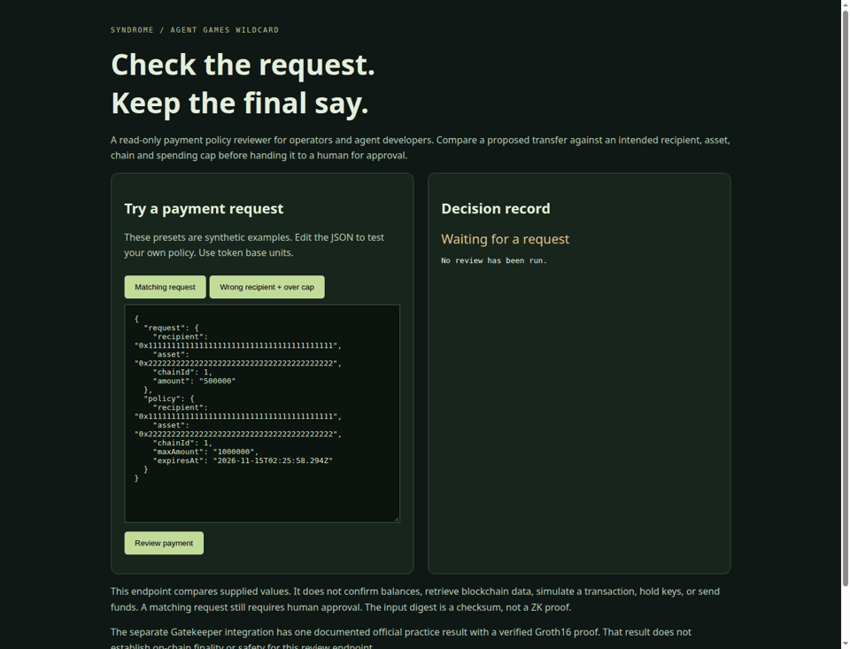

# Syndrome — Payment Review

Read-only payment policy reviewer submitted to Agent Games Wildcard. It compares proposed EVM transfers against a supplied recipient, asset, chain, spending cap and expiry. Mismatches return `REJECT`; matching requests return `REQUIRES_HUMAN_APPROVAL`. It never signs or sends funds.

[Live demo](https://syndrome.kydra.my.id/) · [Demo video](docs/syndrome-demo.mp4)



The clip is a 16-second sequence of actual browser captures from the public demo, not a continuous screen recording. Presets are synthetic and labelled. Responses come from the backend.

## Scope

The reviewer uses deterministic rules, not an LLM. It does not retrieve chain state, verify balances, simulate transactions or establish that a caller-supplied policy is authentic. The returned input digest is a checksum, not a ZK proof. No wallet connection is needed.

## Run locally

Node.js 22+ is required.

    npm ci
    npm run start:wildcard

Open http://127.0.0.1:5180. The standalone Wildcard service requires no HMAC secret and exposes only the read-only demo/API. Use `/usr/bin/npm` on the original host because its default npm executable is broken.

POST `/api/wildcard/review` accepts:

```json
{
  "request": {"recipient":"0x1111111111111111111111111111111111111111","asset":"0x2222222222222222222222222222222222222222","chainId":1,"amount":"500"},
  "policy": {"recipient":"0x1111111111111111111111111111111111111111","asset":"0x2222222222222222222222222222222222222222","chainId":1,"maxAmount":"1000","expiresAt":"2030-01-01T00:00:00.000Z"}
}
```

Amounts are decimal strings in base units and checked as uint256 values. Invalid inputs return 400. Passing a policy never means an asset is safe to transfer.

## Tests

    npm test
    npm run build

The optional real-proof integration test requires official artifacts downloaded first:

    npm run artifacts
    npm run test:proof

The full suite passed 11 tests on the development machine, including local Groth16 generation and stable response replay. TypeScript checking passed. The proof test uses force-exit for snarkjs worker handles; a MaxListeners warning remains under investigation. Passing tests do not establish production payment safety.

## Gatekeeper integration (separate, incomplete)

The signed `/agent` handler is separate from the Wildcard reviewer. One official practice task, `practice_f27a6927-d3fb-4f96-9ed3-e4780ef90f7a`, showed CORRECT DECISION, REJECT / RECIPIENT_MISMATCH, Proof VERIFIED, latency 2139 ms. Practice does not submit proofs to chain. We do not claim finalized on-chain verification or that all scenarios pass.

Gatekeeper approval/finality, proof reuse, competition binding and lifecycle handling remain incomplete. The practice encoding experiment is not promoted to competition. Steal the VFY enrollment was locked at registration. Do not use the signed handler as a production payment authorizer.

## Deployment status

Wildcard was submitted as `Syndrome - Payment Review`; dashboard readback showed PENDING. The local API is now a user systemd service with automatic restart and startup enabled. The public URL now uses a named Cloudflare tunnel at syndrome.kydra.my.id. Both API and tunnel are enabled user systemd services. The hostname survived a tunnel restart; machine/network downtime still affects availability. The original temporary tunnel remains active for the immutable pending submission. Source files and demo remain available through this repository when the tunnel is offline.

Never commit `.env`, runtime data, wallet keys or HMAC secrets. The original host stores credentials outside this repository.
